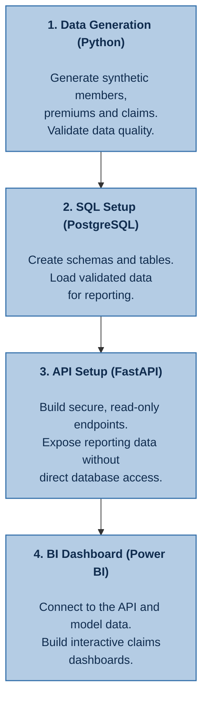
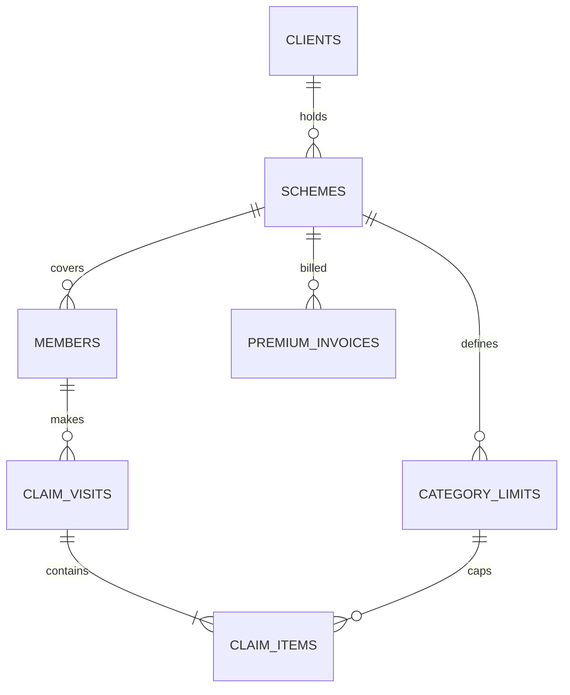

# Healthcare Analytics

An end-to-end analytics project that mimics a real-world health insurance database from data generation, to database configuration and management, to final analytics. We generate the following synthetic data which will ultimately be utilized in Power BI:

- Scheme Membership data
- Medical Claims Data
- Premium data

The full workflow should run end-to-end from data generation to storage to dashboard deployment.

## Table of Contents
- [Healthcare Analytics](#healthcare-analytics)
  - [Table of Contents](#table-of-contents)
  - [Generated Data](#generated-data)
    - [Membership Data](#membership-data)
    - [Claims Data](#claims-data)
    - [Premium Data](#premium-data)
  - [Primary Keys](#primary-keys)
  - [Assumptions](#assumptions)
    - [1. General Assumptions](#1-general-assumptions)
      - [1.1 Simulation Window](#11-simulation-window)
      - [1.2. Client and Scheme](#12-client-and-scheme)
      - [1.3 Geography: urban, peri-urban and rural settings](#13-geography-urban-peri-urban-and-rural-settings)
    - [2. Membership Assumptions](#2-membership-assumptions)
      - [2.1. Member Numberring](#21-member-numberring)
      - [2.2 Principals](#22-principals)
      - [2.3 Dependants and family structure](#23-dependants-and-family-structure)
      - [2.4 Joining and leaving](#24-joining-and-leaving)
    - [3. Claims](#3-claims)
      - [3.1. Benefits \& Limits](#31-benefits--limits)
      - [3.2. Claim Frequency](#32-claim-frequency)
      - [3.3. Maternity](#33-maternity)
      - [3.4 Diagnoses](#34-diagnoses)
      - [3.5 Service lines and providers](#35-service-lines-and-providers)
      - [3.6 Claim costs](#36-claim-costs)

## Generated Data

### Membership Data

| Column | Meaning |
|---|---|
| `Member ID` | Family number (4 digits) + suffix (e.g.: *1024-00*) (*see below for more info on Suffix*) |
| `Relation` | Principal / Spouse / Child |
| `Category` | Linked to benefit limits per member |
| `Gender`, `DOB`, `Marital Status` | Member attributes |
| `Family Size` | `M`, `M+1` … `M+4` |
| `Date Joined`, `Date Left`, `Status` | Coverage period; `Status` = Inactive exactly when `Date Left` is filled |
| `Policy Year` | Current policy year of the scheme |
| `Client Name`, `Client ID`, `Scheme Name`, `Scheme ID` | Client/Scheme info |

*The Suffix is an identifier added at the end of the family (e.g.- 1025) number to distinguish between the Principal Member ("-00"), Spouse ("-01) and Child (where suffix digit is ≥ 1)*

Generator logic is as follows:
- The suffix defines the relations within a family (i.e.- Principal, Spouse, Child), and is treated as a sequence.
- Principals and their existing dependents join on the specified renewal date.
- Newborns are added to the scheme within 30 days from their date of birth.
- Scheme exits can be done at any date except the renewal date.
- A "child" is no longer under cover once they turn 25.
- When a dependant leaves the scheme, the family size remains the same for the current policy year. The change is the applied in the next policy year.
- Family mix: 5 single (M), 2 × M+1, 5 × M+2, 3 × M+3, 1 × M+4. This is a reasonable starting prior for the dependants distribution.
- Category distinctions for benefit limits and premium rating. Categories are written as "Cat A", "Cat B", "Cat C".... and so on each representing employment levels from top-level directors to contract staff. Benefit limit distribution should be reflected the same way.
- Client ID (the company taking cover for its employees) and Scheme ID (the healthcare scheme that runs for a year)

### Claims Data

| Column | Meaning | Generated or derived |
|---|---|---|
| `Claim_No` | The claim ID representing a provider visit | Generated (sequential) |
| `Claimant_ID` | Member number + dependant suffix (e.g. `1111-03`) | From membership |
| `Gender`, `DOB`, `Relation` | Claimant attributes | From membership (never generated independently) |
| `Benefit`, `Category`, `LimitAmount` | e.g. CATEGORY C · Out-Patient · 300,000 | Category from member; limit looked up |
| `AilmentDate` | Date of treatment (incurred date) | Generated |
| `ClaimDate` | Date the claim was received; ≥ `AilmentDate` the gap between `AilmentDate` and `ClaimDate` is lognormally distributed with very few extreme cases of up to 9 months lag | Derived: ailment date + reporting gap |
| `Ailment`| Diagnosis (Detailed level ICD10/11 subcategories) | Generated based on ICD-10/11 categorization |
| `ServiceType` | Drugs, Lab Tests, Consultation, Specialist Fees, Medical Procedures,..... | Generated |
| `Provider` | Facility; `REIMBURSEMENT PROVIDER` = member paid and was refunded | Generated |
| `ClaimedAmount` | The amount invoiced | Generated |
| `SettledAmount` | Amount paid for the line (KES) | Generated, then capped by limits |
| `Policy Year` | 2024 for Jan-2024 claims | Derived from `AilmentDate` and renewal date |
| `Scheme_Name` | `DNS` | From scheme |

Generator logic:
- Under the `Benefit` column consider only the following main Benefits: "Outpatient", "Inpatient", "Maternity", "Dental", "Optical"
- A claim number must only have one claimant per claim
- `Line_No` row so that each row has a unique key

Ailment/Diagnosis Consideration
- A seperate ailment ID table must be in place for guiding the diagnosis categorization
- This is for mapping the diagnoses to their broader categories (i.e.- Top level ICD10/11 categories/chapters)

### Premium Data

| Column | Meaning |
|---|---|
| `Invoice No.` | `INV-…` for invoices, `CN-…` for credit notes |
| `Client_ID`, `Client Name` | One client per industry (5 in total), e.g. `C-10482` · Sunrise Agro Processors Ltd |
| `Invoice Date`, `Effective Date` | Renewals invoiced before renewal date and effective on renewal date (e.g.- Invoiced 15 Dec, effective 1 Jan); endorsements effective within 5 days after invoice date |
| `Premium` | Net premium (the loss-ratio denominator) |
| `Taxes, Levies, Additional Fees` | Statutory charges passed to government |
| `Amount Invoiced` | Premium + taxes (what the client pays) |
| `Invoice Type` | Renewal · Endorsement – Addition · Endorsement – Deletion (Credit Note) |
| `Policy Year` | Policy year of the current scheme |

Generator logic:
- The actual premium, endorsement and credit note amounts are priced from assumptions made on the scheme, its membership, and external statutory factors (see below section)
- Renewals are effective for 1 calendar year (e.g.- 1st Jan - 31st Dec)
- Year on year premium growth is [approximately 20%](https://www.ira.go.ke/lib.html?f=press-release-industry-statistics-2025#:~:text=Deposit%20Administration%2C%20at%20KES%2081.22%20billion%2C%20and,22.30%20per%20cent%20to%20KES%2093.20%20billion.). That growth mixes membership growth with rate increases. In the generator, these should come from two separate sources: member counts and a pricing trend.
- Around 5-6 additions and 2 deletion a year for a particular client's scheme. Additions and deletions are pro-rata adjustments for mid-year joiners and leavers.
- Credit notes for deletions are effective 1 day after the member has left the scheme.
- Earned premium is not part of the generator and will be a derived output.

## Primary Keys

These are keys/IDs that will connect the membership, claims and premium datasets.

Where `claim_visits` represents a particular visit, `claim_items` represents the service provided (e.g.- Consultation, Drugs, Lab Tests, etc....) which can be multiple rows for a single claim number.

## Assumptions
We set core configuration assumptions for the generator to ensure that the generated data is realistic and consistent. Parameters marked as `placeholder` need specific setting for the generator to run.

Monetary values are listed in Kenyan Shillings (KES).

### 1. General Assumptions
#### 1.1 Simulation Window

| Assumption | Value | Basis |
|---|---|---|
| First possible scheme inception | 1 Jan 2022 | Sample (earliest join date) |
| Last ailment date simulated | 30 Sep 2026 | Design |
| Data extraction ("as-at") date | 31 Oct 2026 | Design |
| Random seed | 42; each client has its own stream, so adding a client doesn't change any other client's data | Design |

IBNR (Incurred but not reported) claims are currently excluded from the generator.

#### 1.2. Client and Scheme
| Assumption | Value | Basis |
|---|---|---|
| Client | The company taking cover for its employees (`Client_ID`, e.g. `C-10482`) | Design |
| Scheme | One client's contract for one policy year (`Scheme_ID`, e.g. `C-10482-2024`) | Spec |
| Policy term | 12 months from the renewal date | Spec |
| Policy year label | The year cover starts (1 Jul 2024 – 30 Jun 2025 = PY 2024) | Design |
| Industries (*\*Formal employment in the private sector*)| Manufacturing; Agriculture; Retail; Education; Banking & Finance | [Kenya 2025 Economic Survey](https://www.knbs.or.ke/wp-content/uploads/2025/05/2025-Economic-Survey-Popular-Version.pdf). Banking & Finance added to represent urban-based corporate population. |
| Generated clients | 1 per industry, so 5 clients in total (one each for Manufacturing, Agriculture, Retail, Education, Banking & Finance). Each client runs one scheme per policy year | Design |
| Principals at inception | Company sizes are heavily right skewed with many small firms and a few giants. Consistent with a Lognormal distribution.` Lognormal, median 150 (min 10, max 4,000)`, drawn once per client | Placeholder |
| Renewal month | Drawn once per client using these weights: January 25%, February 8%, March 8%, April 10%, May 5%, June 5%, July 10%, August 6.6%, September 7%, October 6%, November 5%, December 3% | Placeholder |
| Clients already in force on 1 Jan 2022 | 3 of the 5 clients (60%); the other 2 join afterwards | Placeholder |
| Client lapse (does not renew) | 12% chance per client at each renewal; claims already incurred still run off. A lapsed client is not replaced by a new one | Placeholder |

#### 1.3 Geography: urban, peri-urban and rural settings
 
Location is added as one dimension, `setting`, that adjusts existing modules. There are no separate urban and rural generators. Like every other setting, it follows the five-layer resolution order, so an industry, a single client or a single scheme year can override it.
 
**Core settings** (`defaults.geography` in `assumptions.yaml`)
 
| Assumption | Value | Basis |
|---|---|---|
| Settings | Urban, Peri-urban, Rural | Design |
| Member share by setting (default) | Urban 60% · Peri-urban 20% · Rural 20%; used only when no industry share is set | Placeholder |
| Member share by industry | See the table below; since each industry has one client, this is also that client's share | Placeholder |
| Facility cost factor | Urban 1.15 · Peri-urban 1.00 · Rural 0.85, applied on top of the provider tier factor | Placeholder |
| Caesarean share of deliveries | Urban 35% · Peri-urban 28% · Rural 18% | Placeholder; [Kenya Mini-Demographic & Healthcare Survey (2025-2026)](https://www.knbs.or.ke/wp-content/uploads/2026/11/2025-26-Kenya-Mini-Demographic-and-Health-Survey1.pdf) |
| Rural members referred to urban facilities for inpatient care | 35% | Placeholder |
| Setting-specific adjustments | `reference/setting_relativities.csv` (setting × benefit → frequency, reporting lag, birth rate) | Design |

**Member share by setting, per industry** (`industries.<name>.geography` in `assumptions.yaml`; *Placeholders*)

| Industry | Urban | Peri-urban | Rural | Profile |
|---|---|---|---|---|
| Manufacturing | 33.3% | 33.3% | 33.4% | Equal spread across the three settings |
| Agriculture | 15% | 20% | 65% | Mostly rural, where farms, estates and processing sites sit |
| Retail | 40% | 45% | 15% | Mostly peri-urban and urban (town centres, malls, satellite towns); least rural |
| Education | 30% | 40% | 30% | Private schools, colleges and universities cluster in towns and satellite towns, with a sizeable share of boarding schools in rural areas |
| Banking & Finance | 70% | 20% | 10% | Mostly urban (head offices and main branches), fewer peri-urban and rural branches |

The family's setting is drawn from these shares once, at join.
 
**How the setting enters each module**
 
| Module | Urban vs rural effect | Basis |
|---|---|---|
| Member and family attributes | The family's setting is fixed at join and shared by all dependants. Rural families have more children and a higher birth rate (urban total fertility rate 2.6 vs rural 3.6) | [Kenya Mini-Demographic & Healthcare Survey (2025-2026)](https://www.knbs.or.ke/wp-content/uploads/2026/11/2025-26-Kenya-Mini-Demographic-and-Health-Survey1.pdf) |
| Facility location | Each provider carries a `setting` (and ideally a `county`). Cost follows where treatment happens, not where the member lives, so a rural member treated at an urban hospital pays urban prices | Design |
| Visit frequency | Rural members record fewer visits because of access barriers | Design; to be calibrated |
| Diagnoses | Reweighted by setting: malaria, respiratory and waterborne illness higher in rural areas; hypertension and diabetes higher in urban areas | Design; to be calibrated |
| Maternity | Caesarean share and antenatal visits vary by setting (see table above) | [Kenya Mini-Demographic & Healthcare Survey (2025-2026)](https://www.knbs.or.ke/wp-content/uploads/2026/11/2025-26-Kenya-Mini-Demographic-and-Health-Survey1.pdf) |
| Provider choice | Tier mix varies by category × setting. Rural members use tier 3 facilities more, and have a higher reimbursement share (fewer facilities with direct billing) | Design; to be calibrated |
| Reporting lag | Rural claims arrive later (longer median lag) | Design; to be calibrated |
| Seasonality | Malaria peaks differ between highland and lowland regions, so seasonality can vary by setting or region | [Kipruto, E. K. et al. (2017)](https://link.springer.com/10.1186/s12936-017-1848-2); [Munyekenye, O. G. et al. (2005)](https://wwwnc.cdc.gov/eid/article/11/10/05-0106_article) |
| Pricing | Premium rates are **not** rated by setting, matching typical corporate schemes. Rural-heavy and urban-heavy clients therefore end up with different loss ratios | Design |

### 2. Membership Assumptions
#### 2.1. Member Numberring
Member ID format is an n-digit family number (e.g.- 1024) followed by a suffix (e.g.- -00, -01, -02, etc...). Suffixes are sequenced and primarily used to distinguish between the Principal Member, Spouse and Child:
- `-00` = Principal Member
- `-01` = Spouse/Child (first dependent)
- `-02` = Child (second dependent)

and so on...

A member number will never be reused for a different family. Once a family leaves the scheme, their member number is retired permanently. The generator will always generate a new family number for a new family.

#### 2.2 Principals
| Assumption | Value | Basis |
|---|---|---|
| Age range | 18–65 | Design |
| Age–sex profile | Working-age population from the 2019 Census, adjusted per industry | [2019 Kenya Population and Housing Census Volume III: Distribution of Population by Age, Sex and Administrative Units](https://www.knbs.or.ke/?wpdmpro=2019-kenya-population-and-housing-census-volume-iii-distribution-of-population-by-age-sex-and-administrative-units) |
| Female share | 45% by default (Manufacturing 30%; Agriculture, forestry and fishing 45%; Wholesale and retail trade 50%; Education 60%; Construction 20%%) | Placeholder |
| Marital status | Single 45%, Married 50% | Placeholder |

**Category Mix** (*Placeholders*)

Category mix is as follows:
- Cat A: 2% (Top-level directors)
- Cat B: 15% (Middle-level managers)
- Cat C: 70% (Staff employees)
- Cat D: 13% (Contract staff)

Clients can use from 1-4 categories depending on their employee count:
- 1 category: 1–50 employees
- 2 categories: 51–200 employees
- 3 categories: 201–700 employees
- 4 categories: 1,001+ employees

2% of families are promoted to the next category each year.

#### 2.3 Dependants and family structure
 
| Assumption | Value | Basis |
|---|---|---|
| Spouse covered if principal is married | 95% | Placeholder |
| Spouse age gap | Husband older by 2 years on average (StdDev. of 4) | Placeholder |
| Children per family | 0: 20% · 1: 35% · 2: 25% · 3: 15% · 4: 5% | Placeholder |
| Single principals with children | 10% | Placeholder |
| Mother's age at each birth | 18–45 more concentrated around 28-40 | Design |
| Family Size label | `M`, `M+1` … `M+4` | Design |
| Family Size for a scheme year | Family members with any cover that year, minus one: additions count immediately, deletions from the next policy year | Spec |

#### 2.4 Joining and leaving
 
| Assumption | Value | Basis |
|---|---|---|
| Initial members join on | The scheme's renewal date (principals with their existing dependants) | Design |
| New hires (principals) | 12% of active principals a year; join mid-year with their dependants (if any) | Placeholder |
| Family exits | 4% of principals a year by default (along with their dependants if any) | Placeholder |
| Dependant-only exits | 1% a year (e.g. divorce, spouse taking own cover) | Placeholder |
| Exit date | Any day except the renewal date | Design |
| Marriage (adds a spouse) | 3% of single principals a year (from age 28-40) | Placeholder |
| Births | 8% a year per covered woman aged 18–45. Kenya's general fertility rate is 105 births per 1,000 women; the lower figure reflects an urban, employed population (urban total fertility rate 2.6 vs 3.6 rural) | [Kenya Mini-Demographic & Healthcare Survey (2025-2026)](https://www.knbs.or.ke/wp-content/uploads/2026/11/2025-26-Kenya-Mini-Demographic-and-Health-Survey1.pdf); Placeholder |
| Newborn added to cover | 1–30 days after birth (uniform) | Design |
| Child age limit | Cover ends on the 25th birthday (moved one day if that falls on the renewal date) | Design |
| Net principal growth | About 8% a year (12% joiners − 4% exits) | Design |
| `Status` | `Inactive` exactly when `Date Left` is filled | Design |

### 3. Claims
#### 3.1. Benefits & Limits
| Assumption | Value | Basis |
|---|---|---|
| Benefits | Outpatient, Inpatient, Maternity, Dental, Optical | Design |
| Limit ordering | Highest for Cat A, falling to Cat D | Design |
| Limits for `C-10482` | From the sample, e.g. Cat C Outpatient KES 300,000 | Design |
| Limits for generated clients | Client "richness" factor (lognormal, median 1.0, sigma 0.25), rounded to KES 50,000 | Design |
| Limit basis | Shared by the family for Inpatient, Outpatient and Maternity; per member for Dental and Optical | Design. We apply a standard limit basis for simplicity. Though in the real world, client benefit specifications vary greatly. |
| Limit reviews at renewal | None for now. Benefit limits remain year on year. | Placeholder |
| Settled amounts | Capped at the remaining limit, applied in date order | Spec |

#### 3.2. Claim Frequency
| Assumption | Value | Basis |
|---|---|---|
| Age and sex effect | U-shaped: high under 5, lowest at 10–24, rising after 40; higher for women of childbearing age | Design; to be calibrated |
| Category effect | Cat A 1.30 · Cat B 1.15 · Cat C 1.00 · Cat D 0.90 · Cat E 0.80 | Placeholder |
| Chronic conditions | Members are assigned conditions by age and sex. Kenya's 2015 STEPwise survey found 23.8% of adults with raised blood pressure and 3.1% with type 2 diabetes | [Socio-economic and demographic determinants of non-communicable diseases in Kenya](https://www.panafrican-med-journal.com//content/article/37/351/full) |
| Effect of a chronic condition | 2.5× visit frequency | Placeholder |
| One claimant per claim | Always | Design |

Below table places initial statistical assumptions on per benefit frequency.

| Benefit | Annual mean, dispersion | Distribution | Reason |
| :--- | :--- | :--- | :--- |
| Outpatient | 3.5, 1.5 | Negative binomial | Frequent visits, substantial member-level variation |
| Inpatient | 0.06 | Poisson | Relatively rare events |
| Dental | 0.35, 1 | Negative binomial | Infrequent, but potentially concentrated among certain members |
| Optical | 0.20 | Poisson | Relatively infrequent events; simpler starting assumption |

For IP benefit, Poisson is a good starting point though since IP claims while not very frequent, may be concentrated among members with chronic conditions which is more indicative of a negative binomial distribution. Poisson cannot capture the overdispersion in such data ([Alexandrou-Majaj (2026)](https://fse.studenttheses.ub.rug.nl/37467/1/BachelorsProjectDRAFTFINAL.pdf))

#### 3.3. Maternity 
| Assumption | Value | Basis |
|---|---|---|
| Source of maternity claims | Generated from simulated births, so the newborns in membership and the maternity claims always agree | Design |
| Eligible members | Female principals and spouses aged 18–49 | Design |
| Antenatal visits | Poisson, mean 4. Nationally,72% of the 
women had at least four ANC visits during their most 
recent pregnancy | [Kenya Mini-Demographic & Healthcare Survey (2025-2026)](https://www.knbs.or.ke/wp-content/uploads/2026/11/2025-26-Kenya-Mini-Demographic-and-Health-Survey1.pdf) |
| Caesarean share |  **20.3%** of live births, or **20.4%** when including stillbirths | [Kenya Mini-Demographic & Healthcare Survey (2025-2026)](https://www.knbs.or.ke/wp-content/uploads/2026/11/2025-26-Kenya-Mini-Demographic-and-Health-Survey1.pdf) |
| Pregnancy loss | 1% of all pregnancies resulted in still briths, 9% resulted in miscarriages, <1% for induced abortions, 89% successfull births | Placeholder |

#### 3.4 Diagnoses
 
| Assumption | Value | Basis |
|---|---|---|
| Coding system | ICD-10 (WHO 2019 version), with ICD-11 codes carried alongside where mapped | [WHO ICD-10 Version 2019](https://icd.who.int/browse10/2019/en) |
| Level of detail | Subcategory codes (e.g. `J06.9`), each mapped to one of the 22 ICD-10 chapters | [WHO ICD-10 Version 2019](https://icd.who.int/browse10/2019/en) |
| Diagnoses per visit | 1 | Design |
| Ailment choice | Filtered by benefit, age and sex, weighted by base frequency, chronic status and industry-specific occupational risk | Design |

#### 3.5 Service lines and providers
 
| Assumption | Value | Basis |
|---|---|---|
| Service lines per claim | Outpatient 2.2 · Inpatient 6.0 · Maternity 4.0 · Dental 1.5 · Optical 1.8 (means) | Placeholder |
| Service types | Consultation, Specialist, Drugs, Lab Tests, Radiology, minor procedures, surgical procedures, dental consultation, fillings, extractions, dentures, eye tests, lenses, frames, contact lenses, physiotherapy, antenatal care, delivery, postnatal care, hospital admission, accommodation, nursing, emergency treatment, ambulance services, mental health, dialysis, chemotherapy, radiotherapy, medical appliances, screening, vaccinations, wellness, e.t.c...... | Sample |
| Provider tiers | Three tiers; senior categories use tier 1 more often | Design |
| Reimbursement claims (member paid, then refunded) | 5% of visits, shown as `REIMBURSEMENT` | Placeholder |

#### 3.6 Claim costs
 
| Assumption | Value | Basis |
|---|---|---|
| Cost per line | Lognormal by service type (2019 prices), with SHA tariffs as a floor and private-hospital prices above them. For example, SHA pays KES 11,200 for a normal delivery and KES 32,600 for a caesarean while Tier 1 private hospitals charge around 210,000 for a caesarean | [AGKUN Maternity Delivery Services] |
| Provider tier factor | Tier 1 × 1.4 · Tier 2 × 1.0 · Tier 3 × 0.75 | Placeholder |
| Large inpatient claims | Above KES 500,000, costs follow a Pareto tail (α = 2) | Placeholder |
| Medical inflation | 10% a year. WTW projects 12.1% gross medical trend for the Middle East and Africa in 2025 (10.4% in 2024); Aon's 2025 global average is 10.0% | [WTW 2024](https://www.wtwco.com/en-hr/insights/2024/10/2025-global-medical-trends-survey); [AON 2024](https://www.aon.com/en/insights/reports/gmtr) |
| `ClaimedAmount` vs `SettledAmount` | 15% of lines are paid below the amount claimed (average shortfall about 20%); 2% are declined | Placeholder |