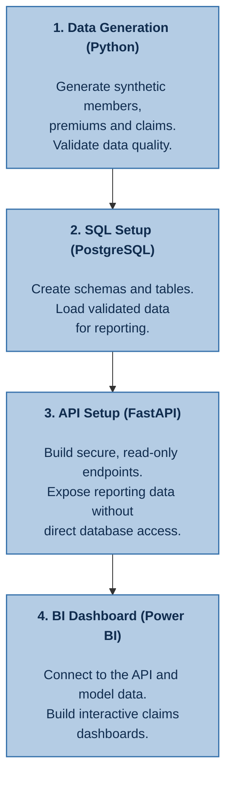
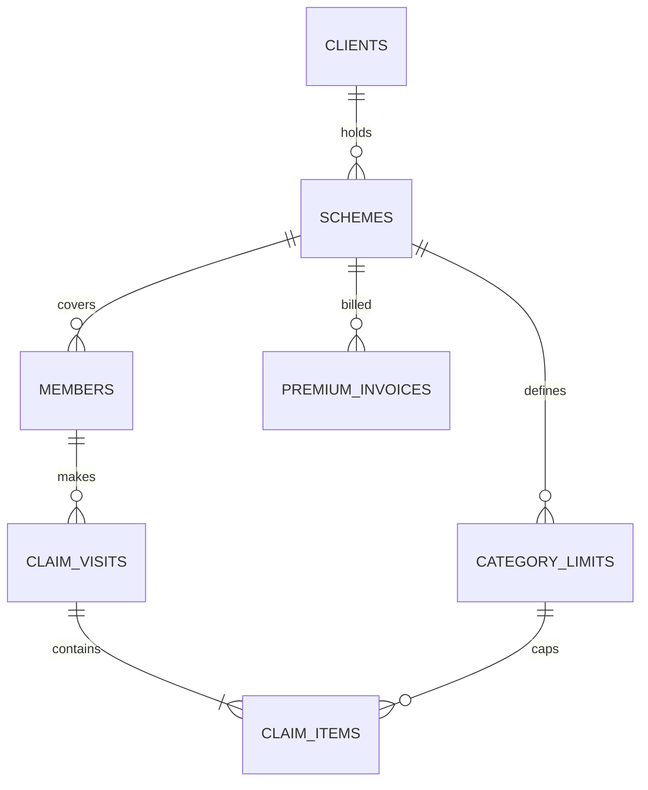

# Healthcare Analytics

An end-to-end analytics project that mimics a real-world health insurance database from data generation, to database configuration and management, to final analytics. We generate the following synthetic data which will ultimately be utilized in Power BI:

- Scheme Membership data
- Medical Claims Data
- Premium data

The full workflow should run end-to-end from data generation to storage to dashboard deployment.

## Table of Contents
- [Healthcare Analytics](#healthcare-analytics)
  - [Table of Contents](#table-of-contents)
  - [Generated Data](#generated-data)
    - [Membership Data](#membership-data)
    - [Claims Data](#claims-data)
    - [Premium Data](#premium-data)
  - [Primary Keys](#primary-keys)
  - [Assumptions](#assumptions)
    - [1. General Assumptions](#1-general-assumptions)
      - [1.1 Simulation Window](#11-simulation-window)
      - [1.2. Client and Scheme](#12-client-and-scheme)

## Generated Data

### Membership Data

| Column | Meaning |
|---|---|
| `Member ID` | Family number (4 digits) + suffix (e.g.: *1024-00*) (*see below for more info on Suffix*) |
| `Relation` | Principal / Spouse / Child |
| `Category` | Linked to benefit limits per member |
| `Gender`, `DOB`, `Marital Status` | Member attributes |
| `Family Size` | `M`, `M+1` … `M+4` |
| `Date Joined`, `Date Left`, `Status` | Coverage period; `Status` = Inactive exactly when `Date Left` is filled |
| `Policy Year` | Current policy year of the scheme |
| `Client Name`, `Client ID`, `Scheme Name`, `Scheme ID` | Client/Scheme info |

*The Suffix is an identifier added at the end of the family (e.g.- 1025) number to distinguish between the Principal Member ("-00"), Spouse ("-01) and Child (where suffix digit is ≥ 1)*

Generator logic is as follows:
- The suffix defines the relations within a family (i.e.- Principal, Spouse, Child), and is treated as a sequence.
- Principals and their existing dependents join on the specified renewal date.
- Newborns are added to the scheme within 30 days from their date of birth.
- Scheme exits can be done at any date except the renewal date.
- A "child" is no longer under cover once they turn 25.
- When a dependant leaves the scheme, the family size remains the same for the current policy year. The change is the applied in the next policy year.
- Family mix: 5 single (M), 2 × M+1, 5 × M+2, 3 × M+3, 1 × M+4. This is a reasonable starting prior for the dependants distribution.
- Category distinctions for benefit limits and premium rating. Categories are written as "Cat A", "Cat B", "Cat C".... and so on each representing employment levels from top-level directors to contract staff. Benefit limit distribution should be reflected the same way.
- Client ID (the company taking cover for its employees) and Scheme ID (the healthcare scheme that runs for a year)

### Claims Data

| Column | Meaning | Generated or derived |
|---|---|---|
| `Claim_No` | The claim ID representing a provider visit | Generated (sequential) |
| `Claimant_ID` | Member number + dependant suffix (e.g. `1111-03`) | From membership |
| `Gender`, `DOB`, `Relation` | Claimant attributes | From membership (never generated independently) |
| `Benefit`, `Category`, `LimitAmount` | e.g. CATEGORY C · Out-Patient · 300,000 | Category from member; limit looked up |
| `AilmentDate` | Date of treatment (incurred date) | Generated |
| `ClaimDate` | Date the claim was received; ≥ `AilmentDate` the gap between `AilmentDate` and `ClaimDate` is lognormally distributed with very few extreme cases of up to 9 months lag | Derived: ailment date + reporting gap |
| `Ailment`| Diagnosis (Detailed level ICD10/11 subcategories) | Generated based on ICD-10/11 categorization |
| `ServiceType` | Drugs, Lab Tests, Consultation, Specialist Fees, Medical Procedures,..... | Generated |
| `Provider` | Facility; `REIMBURSEMENT PROVIDER` = member paid and was refunded | Generated |
| `ClaimedAmount` | The amount invoiced | Generated |
| `SettledAmount` | Amount paid for the line (KES) | Generated, then capped by limits |
| `Policy Year` | 2024 for Jan-2024 claims | Derived from `AilmentDate` and renewal date |
| `Scheme_Name` | `DNS` | From scheme |

Generator logic:
- Under the `Benefit` column consider only the following main Benefits: "Outpatient", "Inpatient", "Maternity", "Dental", "Optical"
- A claim number must only have one claimant per claim
- `Line_No` row so that each row has a unique key

Ailment/Diagnosis Consideration
- A seperate ailment ID table must be in place for guiding the diagnosis categorization
- This is for mapping the diagnoses to their broader categories (i.e.- Top level ICD10/11 categories/chapters)

### Premium Data

| Column | Meaning |
|---|---|
| `Invoice No.` | `INV-…` for invoices, `CN-…` for credit notes |
| `Client_ID`, `Client Name` | `C-10482` · Sunrise Agro Processors Ltd (one client) |
| `Invoice Date`, `Effective Date` | Renewals invoiced before renewal date and effective on renewal date (e.g.- Invoiced 15 Dec, effective 1 Jan); endorsements effective within 5 days after invoice date |
| `Premium` | Net premium (the loss-ratio denominator) |
| `Taxes, Levies, Additional Fees` | Statutory charges passed to government |
| `Amount Invoiced` | Premium + taxes (what the client pays) |
| `Invoice Type` | Renewal · Endorsement – Addition · Endorsement – Deletion (Credit Note) |
| `Policy Year` | Policy year of the current scheme |

Generator logic:
- The actual premium, endorsement and credit note amounts are priced from assumptions made on the scheme, its membership, and external statutory factors (see below section)
- Renewals are effective for 1 calendar year (e.g.- 1st Jan - 31st Dec)
- Year on year premium growth is [approximately 20%](https://www.ira.go.ke/lib.html?f=press-release-industry-statistics-2025#:~:text=Deposit%20Administration%2C%20at%20KES%2081.22%20billion%2C%20and,22.30%20per%20cent%20to%20KES%2093.20%20billion.). That growth mixes membership growth with rate increases. In the generator, these should come from two separate sources: member counts and a pricing trend.
- Around 5-6 additions and 2 deletion a year for a particular client's scheme. Additions and deletions are pro-rata adjustments for mid-year joiners and leavers.
- Credit notes for deletions are effective 1 day after the member has left the scheme.
- Earned premium is not part of the generator and will be a derived output.

## Primary Keys

These are keys/IDs that will connect the membership, claims and premium datasets.

Where `claim_visits` represents a particular visit, `claim_items` represents the service provided (e.g.- Consultation, Drugs, Lab Tests, etc....) which can be multiple rows for a single claim number.

## Assumptions
We set core configuration assumptions for the generator to ensure that the generated data is realistic and consistent. Parameters marked as `placeholder` need specific setting for the generator to run.

Monetary values are listed in Kenyan Shillings (KES).

### 1. General Assumptions
#### 1.1 Simulation Window

| Assumption | Value | Basis |
|---|---|---|
| First possible scheme inception | 1 Jan 2022 | Sample (earliest join date) |
| Last ailment date simulated | 30 Sep 2026 | Design |
| Data extraction ("as-at") date | 31 Oct 2026 | Design |
| Random seed | 42; each client has its own stream, so adding a client doesn't change any other client's data | Design |

IBNR (Incurred but not reported) claims are currently excluded from the generator.

#### 1.2. Client and Scheme
| Assumption | Value | Basis |
|---|---|---|
| Client | The company taking cover for its employees (`Client_ID`, e.g. `C-10482`) | Design |
| Scheme | One client's contract for one policy year (`Scheme_ID`, e.g. `C-10482-2024`) | Spec |
| Policy term | 12 months from the renewal date | Spec |
| Policy year label | The year cover starts (1 Jul 2024 – 30 Jun 2025 = PY 2024) | Design |
| Hand-specified client | While clients can be autogenerated, the generator also allows explicitly specifying clients for data generation | Sample |
| Generated clients | 5 | Placeholder |
| Industry mix (*\*Formal employment in the private sector*)| Manufacturing 25%, Agriculture, forestry and fishing 22%, Wholesale and retail trade 19.75%, Education 18%, Construction 16% | [Kenya 2025 Economic Survey](https://www.knbs.or.ke/wp-content/uploads/2025/05/2025-Economic-Survey-Popular-Version.pdf) |
| Principals at inception | Company sizes are heavily right skewed with many small firms and a few giants. Consistent with a Lognormal distribution.` Lognormal, median 150 (min 10, max 4,000)` | Placeholder |
| Renewal month | January 25%, February 8%, March 8%, April 10%, May 5%, June 5%, July 10%, August 6.6%, September 7%, October 6%, November 5%, December 3% | Placeholder |
| Clients already in force on 1 Jan 2022 | 60%; the rest join afterwards | Placeholder |
| Client lapse (does not renew) | 12% at each renewal; claims already incurred still run off | Placeholder |