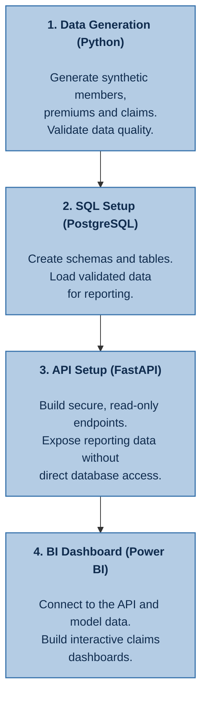
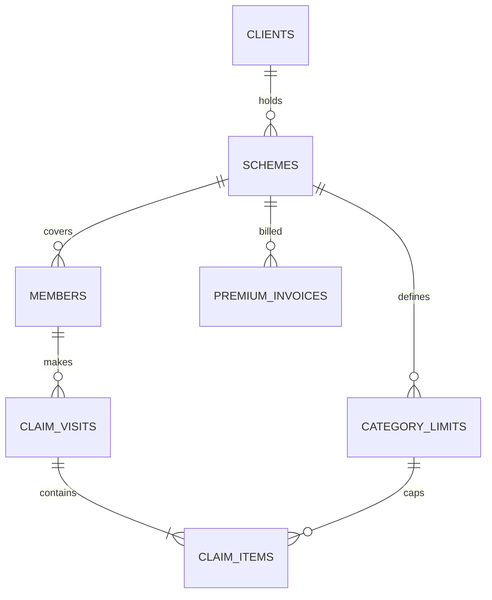

# Healthcare Analytics

An end-to-end analytics project that mimics a real-world health insurance database. We generate synthetic the following synthetic data which will ultimately be utilized in Power BI:

- Scheme Membership data
- Medical Claims Data
- Premium data

The full workflow should run end-to-end from data generation to storage to dashboard deployment.

## Table of Contents
- [Healthcare Analytics](#healthcare-analytics)
  - [Table of Contents](#table-of-contents)
  - [Generated Data](#generated-data)
    - [Membership Data](#membership-data)
    - [Claims Data](#claims-data)
    - [Premium Data](#premium-data)
  - [Grain Summary](#grain-summary)
  - [Primary Keys](#primary-keys)
  - [Reference sources and calibration targets](#reference-sources-and-calibration-targets)
  - [Reference and Assumptions Configuration](#reference-and-assumptions-configuration)

## Generated Data

### Membership Data

| Column | Meaning |
|---|---|
| `Member ID` | Family number (4 digits) + suffix (e.g.: *1024-00*) (*see below for more info on Suffix*) |
| `Relation` | Principal / Spouse / Child |
| `Category` | Linked to benefit limits per member |
| `Gender`, `DOB`, `Marital Status` | Member attributes |
| `Family Size` | `M`, `M+1` … `M+4` |
| `Date Joined`, `Date Left`, `Status` | Coverage period; `Status` = Inactive exactly when `Date Left` is filled |
| `Policy Year` | Current policy year of the scheme |
| `Client Name`, `Client ID`, `Scheme Name`, `Scheme ID` | Client/Scheme info |

*The Suffix is an identifier added at the end of the family (e.g.- 1025) number to distinguish between the Principal Member ("-00"), Spouse ("-01) and Child (where suffix digit is ≥ 1)*

Generator logic is as follows:
- The suffix defines the relations within a family (i.e.- Principal, Spouse, Child), and is treated as a sequence.
- Principals and their existing dependents join on the specified renewal date.
- Newborns are added to the scheme within 30 days from their date of birth.
- Scheme exits can be done at any date except the renewal date.
- A "child" is no longer under cover once they turn 25.
- When a dependant leaves the scheme, the family size remains the same for the current policy year. The change is the applied in the next policy year.
- Family mix: 5 single (M), 2 × M+1, 5 × M+2, 3 × M+3, 1 × M+4. This is a reasonable starting prior for the dependants distribution.
- Category distinctions for benefit limits and premium rating. Categories are written as "Cat A", "Cat B", "Cat C".... and so on each representing employment levels from top-level directors to contract staff. Benefit limit distribution should be reflected the same way.
- Client ID (the company taking cover for its employees) and Scheme ID (the healthcare scheme that runs for a year)

### Claims Data

| Column | Meaning | Generated or derived |
|---|---|---|
| `Claim_No` | The claim ID representing a provider visit | Generated (sequential) |
| `Claimant_ID` | Member number + dependant suffix (e.g. `1111-03`) | From membership |
| `Gender`, `DOB`, `Relation` | Claimant attributes | From membership (never generated independently) |
| `Benefit`, `Category`, `LimitAmount` | e.g. CATEGORY C · Out-Patient · 300,000 | Category from member; limit looked up |
| `AilmentDate` | Date of treatment (incurred date) | Generated |
| `ClaimDate` | Date the claim was received; ≥ `AilmentDate` the gap between `AilmentDate` and `ClaimDate` is lognormally distributed with very few extreme cases of up to 9 months lag | Derived: ailment date + reporting gap |
| `Ailment`| Diagnosis (Detailed level ICD10/11 subcategories) | Generated based on ICD-10/11 categorization |
| `ServiceType` | Drugs, Lab Tests, Consultation, Specialist Fees, Medical Procedures,..... | Generated |
| `Provider` | Facility; `REIMBURSEMENT PROVIDER` = member paid and was refunded | Generated |
| `ClaimedAmount` | The amount invoiced | Generated |
| `SettledAmount` | Amount paid for the line (KES) | Generated, then capped by limits |
| `Policy Year` | 2024 for Jan-2024 claims | Derived from `AilmentDate` and renewal date |
| `Scheme_Name` | `DNS` | From scheme |

Generator logic:
- Under the `Benefit` column consider only the following main Benefits: "Outpatient", "Inpatient", "Maternity", "Dental", "Optical"
- A claim number must only have one claimant per claim
- `Line_No` row so that each row has a unique key

Ailment/Diagnosis Consideration
- A seperate ailment ID table must be in place for guiding the diagnosis categorization
- This is for mapping the diagnoses to their broader categories (i.e.- Top level ICD10/11 categories/chapters)

### Premium Data

| Column | Meaning |
|---|---|
| `Invoice No.` | `INV-…` for invoices, `CN-…` for credit notes |
| `Client_ID`, `Client Name` | `C-10482` · Sunrise Agro Processors Ltd (one client) |
| `Invoice Date`, `Effective Date` | Renewals invoiced before renewal date and effective on renewal date (e.g.- Invoiced 15 Dec, effective 1 Jan); endorsements effective within 5 days after invoice date |
| `Premium` | Net premium (the loss-ratio denominator) |
| `Taxes, Levies, Additional Fees` | Statutory charges passed to government |
| `Amount Invoiced` | Premium + taxes (what the client pays) |
| `Invoice Type` | Renewal · Endorsement – Addition · Endorsement – Deletion (Credit Note) |
| `Policy Year` | Policy year of the current scheme |

Generator logic:
- The actual premium, endorsement and credit note amounts are priced from assumptions made on the scheme, its membership and external statutory factors (see below section)
- Renewals are effective for 1 calendar year (e.g.- 1st Jan - 31st Dec)
- Year on year premium growth is [approximately 20%](https://www.ira.go.ke/lib.html?f=press-release-industry-statistics-2025#:~:text=Deposit%20Administration%2C%20at%20KES%2081.22%20billion%2C%20and,22.30%20per%20cent%20to%20KES%2093.20%20billion.). That growth mixes membership growth with rate increases. In the generator, these should come from two separate sources: member counts and a pricing trend.
- Around 5-6 additions and 2 deletion a year for a particular client's scheme. Additions and deletions are pro-rata adjustments for mid-year joiners and leavers.
- Credit notes for deletions are effective 1 day after the member has left the scheme.
- Earned premium is not part of the generator and will be a derived output.

## Grain Summary

| Dataset | One row represents | Natural key | Generator outputs |
|---|---|---|---|
| Claims | One service line on a claim | `Claim_No` + `Line_No` | `claim_visit` (a particular visit), `claim_items` (service type per visit; should be one row line per visit), layout is defined in above table|
| Membership | One covered person | `Client_ID` + `Member_ID` | `members` (layout defined above) |
| Premium | One invoice / credit note | `Invoice_No` | `premium_invoices` |

## Primary Keys

These are the keys that will connect the membership, claims and premium datasets.

Notes:
- The key split. Client_ID (e.g. C-10482) should identifies the client only. A scheme needs its own key, such as Scheme_ID, with Client_ID as a foreign key, plus a scheme name and its start and end dates or policy year. 
- A scheme is defined as a one policy-year contract, so a client has one scheme row per year. Members, invoices, claims and limits link to the scheme for that year. A member who stays for several years then appears under several schemes, so MEMBERS would need a link to the client as well, or a member-per-scheme-year row.

| Link | Join on | Rule to enforce |
|---|---|---|
| Claims -> Membership | `Client_ID` + `Claimant_ID` = `Member_ID` | Member must be covered on `AilmentDate` (joined ≤ date ≤ left); Gender, DOB, Rel must match |
| Claims -> Limits | `Client_ID` + `Policy_Year` + `Category` + `Benefit` | Settled amounts can't exceed the remaining limit |
| Membership -> Family | First 4 digits of `Member_ID` (`Family_No`) | Exactly one `-00` principal per family; dependants join on or after the principal |
| Premium -> Claims / Membership | `Client_ID` + `Policy_Year` (or month, using earned premium) | Premium has no member link, so loss ratio is computed at client × period level |
| Policy Year (everywhere) | Derived from a date against the renewal date (1 Jan, so it equals the calendar year here) | Claims: from `AilmentDate`; premium: from `Effective Date`; members: `Policy Year` stays as the join year |

## Reference sources and calibration targets
 
Data generated will be based on existing real-world medical claims data from sources listed below. The generated data will be calibrated to match the targets set by the reference sources and assumptions. Assumptions are marked in green. Targets live in their own file (`calibration_targets.yaml`), separate from the generator inputs, so the realism report can check outputs against them.
 
| # | Calibration target | Metric | Reference source | Config section it tunes |
|---|---|---|---|---|
| 1 | Principal age–sex profile | Share of principals by 5-year band × sex | KNBS 2019 Census (working-age population), adjusted for the chosen industry | `population.principals` |
| 2 | Family structure | Dependants per principal; `M` … `M+4` mix; spouse rate | KDHS (household size, marriage), plus the sample mix as a prior | `population.dependants` |
| 3 | Births and age-outs | Newborn additions per 1,000 women of childbearing age a year; child exit age | KDHS fertility rates; policy wording | `population.lifecycle` |
| 4 | Joiner and leaver rates | Annual % new principals and % exits | Sample (~10 of 41 inactive over 7 years); employer turnover assumption | `population.lifecycle` |
| 5 | Utilisation by age and sex | OP visits per member per year; IP admissions per 1,000, by band | KDHS health-seeking data; Synthea as a method reference (the U-shaped age curve) | `utilisation.frequency` |
| 6 | Cost per visit | Mean and median cost per line by service type and provider tier | SHA tariff schedules as a floor (private tariffs sit above them) | `severity` |
| 7 | IP vs OP share of spend | % of settled amount by benefit | IRA Kenya insurance industry reports (medical class) | `utilisation` and `severity.inpatient_tail` |
| 8 | Cost concentration | % of spend from the top 1% and top 5% of members | Typical medical portfolio pattern; set as a range | `severity.inpatient_tail`, `chronic` |
| 9 | Seasonality | Monthly claim-count index (long rains Mar–May, short rains Oct–Dec) | Malaria and respiratory seasonality (KNBS / Ministry of Health data) | `time.seasonality` |
| 10 | Medical inflation | Year-on-year rise in average cost per line | KNBS Economic Survey (CPI health component) | `time.medical_inflation` |
| 11 | Loss ratio | Incurred claims ÷ earned premium by year | IRA industry reports (medical class claims ratio) | `premium.loadings`, `premium.target_loss_ratio` |
| 12 | Reporting lag | Days from ailment to claim date by benefit | Should ideally be within 90 days. Lag is under 30 days for *majority* OP/DEN/OPT/MAT cases. IP cases can take longer  | `lag` |
| 13 | Taxes and levies | 0.20% Insurance Training Levy + 0.25% Policyholder's Compensation Fund (PCF) + KES 40 stamp duty each per policyholder | statutory rates | `premium.taxes` |
| 14 | Benefit limits | Limit by category × benefit | Sample (C OP 300k, D OP 600k) | `config/reference/category_limits.csv` |

## Reference and Assumptions Configuration
Values marked as `# placeholder` need calibrating against as per the previous section those marked with `#doc` are as specified in the README.

